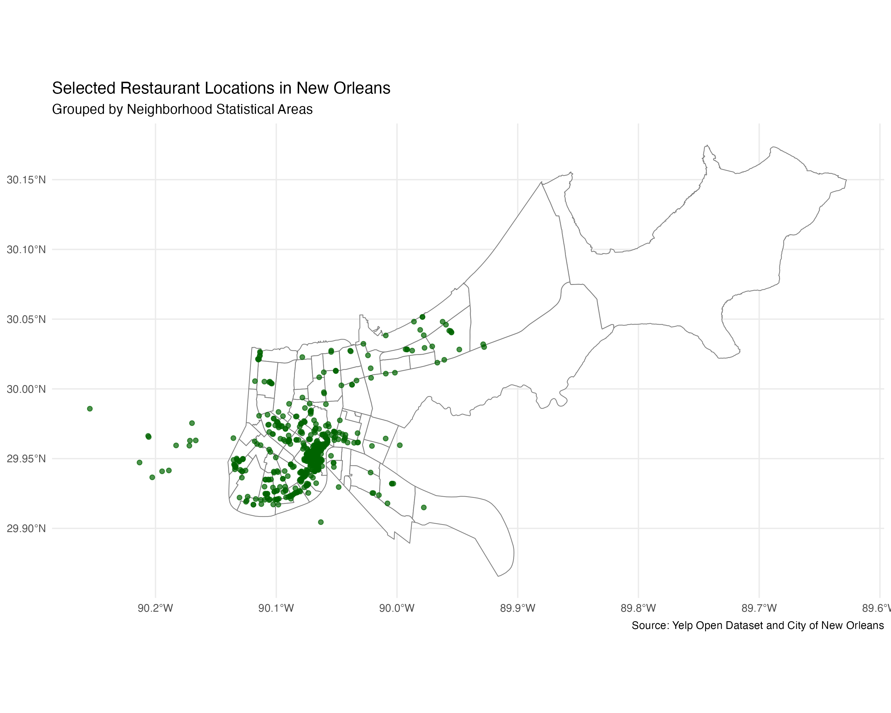
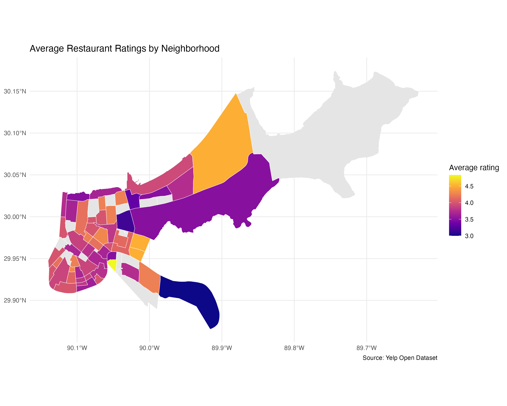
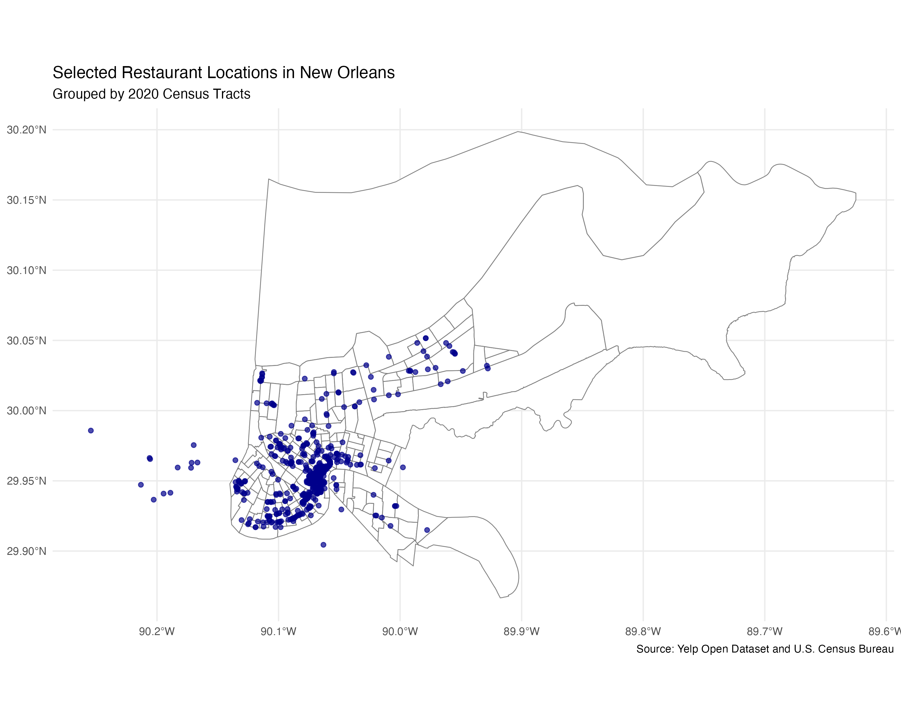

# MATH167R-Project2

## Geographic Analysis
  I compared 2 Geographic systems for analyzing restaurant distribution: NSA and 2020.

### Geographic Comparison Table
See [geography_comparison.csv](output/geography_comparison.csv).

### NSA: Restaurant Distribution

### NSA: Average Ratings

### Census Tract: Restaurant Distribution

### Source Code
[View Steps 3-6 Analysis](R/step3_to_step6.R)
